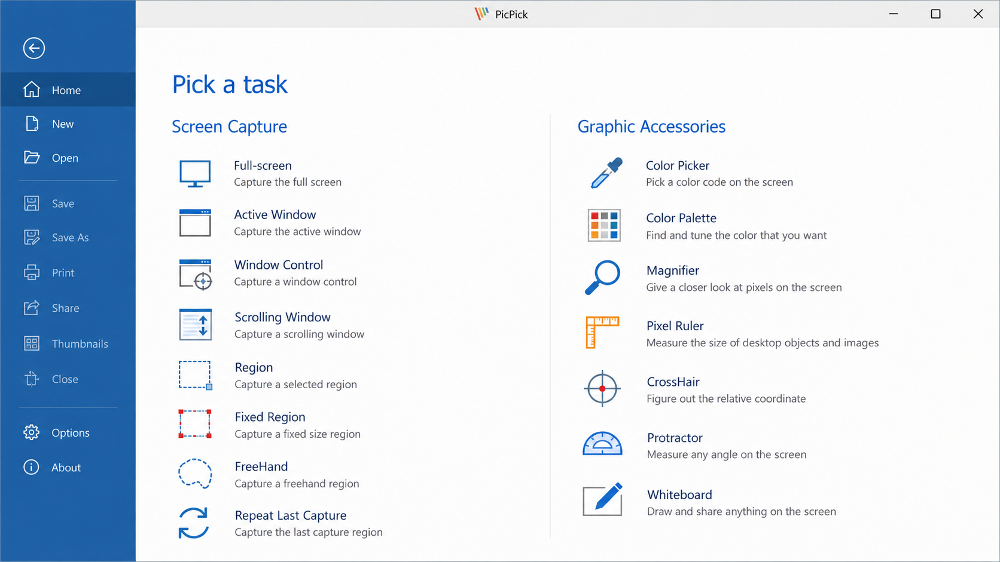
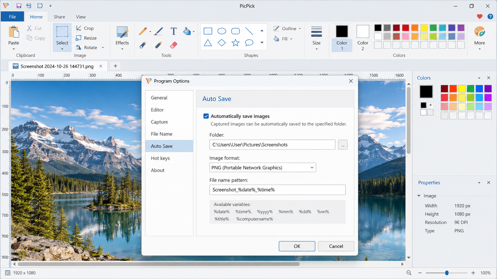
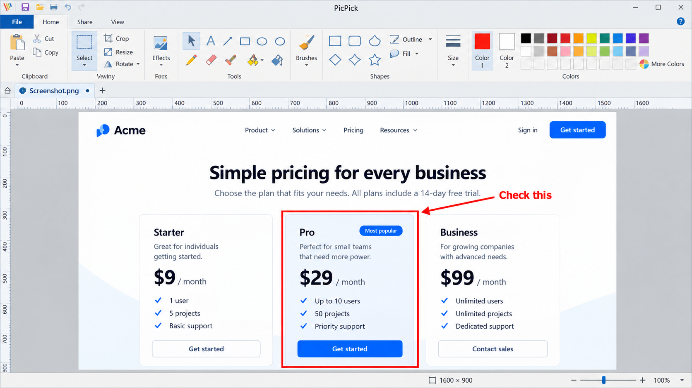

# PicPick Screen Capture - Windows Screenshot, Recording, And Image Editing Software

PicPick Screen Capture is the PicPick Professional repository for Windows screen capture, scrolling screenshots, screen recording, image annotation, and practical design utilities. PicPick software combines capture workflows, a screenshot editor, a color picker, a pixel ruler, and a whiteboard in one desktop application.

### PicPick Workflow

picpick screen capture, picpick screenshot, picpick image editor, picpick screen recorder, picpick professional, screen-capture, screenshot, image-editor, screen-recorder, scrolling-screenshot, windows, image-annotation, color-picker

## Preview

PicPick Screen Capture provides a focused Windows interface for selecting capture modes, editing results, and configuring application behavior.

## Index

- Features
- Supported Screenshot Types
- Screenshot And Screen Recording Features
- Region Capture And Annotation
- Built-In Image Editor
- Productivity Tools
- Custom Workflows And Hotkeys
- Installation
- About This Repository
- Getting Started For Developers
- Validation
- Changelogs
- Privacy Policy
- License
- Contribute

## Features

PicPick Professional brings the main PicPick screenshot workflows into one application:

- Fullscreen capture across the desktop.
- Active-window and selected-window capture.
- Active-monitor capture.
- Custom rectangular region capture.
- Last-region capture.
- PicPick scrolling screenshot capture for long pages and windows.
- PicPick video capture with system audio and microphone input.
- Screenshot annotation with arrows, text, shapes, highlights, blur, and pixelation.
- Cropping, resizing, metadata inspection, and watermark support.
- Configurable hotkeys for frequently used capture modes.
- A PicPick color picker for inspecting screen colors.
- A PicPick pixel ruler and other visual measurement utilities.
- A PicPick whiteboard for drawing and presenting ideas.

PicPick Screen Capture is designed for project managers, developers, designers, technical writers, support teams, educators, testers, and other Windows users who regularly prepare visual documentation.

### What is PicPick used for?

PicPick is used to capture, record, annotate, edit, and organize visual information from a Windows desktop. A user can take a PicPick screenshot of the entire display, an active window, a monitor, or a custom region. The PicPick scrolling screenshot workflow is useful when a page or PicPick scrolling window extends beyond the visible screen.

After capture, the PicPick image editor can add arrows, text, shapes, highlights, blur, pixelation, and numbered steps. These features make PicPick screenshot annotation suitable for bug reports, tutorials, support replies, training material, and product documentation. PicPick Screen Capture also supports recording workflows and design utilities such as the PicPick color picker, PicPick pixel ruler, and PicPick whiteboard.

## Supported Screenshot Types

| Capture Type | Purpose | Selected Implementation |
| --- | --- | --- |
| Fullscreen | Capture the complete desktop | [`CaptureFullscreen.cs`](src/CaptureFullscreen.cs) |
| Active window | Capture the foreground window | [`CaptureActiveWindow.cs`](src/CaptureActiveWindow.cs) |
| Active monitor | Capture the current monitor | [`CaptureActiveMonitor.cs`](src/CaptureActiveMonitor.cs) |
| Custom region | Select a rectangular desktop area | [`CaptureCustomRegion.cs`](src/CaptureCustomRegion.cs) |
| Last region | Repeat the previous selection | [`CaptureLastRegion.cs`](src/CaptureLastRegion.cs) |
| Window | Select a specific window | [`WindowCapture.cs`](src/WindowCapture.cs) |
| Scrolling content | Combine content beyond the viewport | [`ScrollingCaptureService.cs`](src/ScrollingCaptureService.cs) |
| Clipboard | Use image content already copied | [`ClipboardCaptureSource.cs`](src/ClipboardCaptureSource.cs) |

The central PicPick screen capture flow is represented by [`CapturePipeline.cs`](src/CapturePipeline.cs), while capture choices are described by [`CaptureMode.cs`](src/CaptureMode.cs) and [`ScreenCaptureMode.cs`](src/ScreenCaptureMode.cs).

## Screenshot And Screen Recording Features

PicPick Screen Capture supports fast screenshot workflows through configurable capture modes and hotkeys. Capture results can move through the clipboard, editor, file, or another configured destination. The selected implementation includes dedicated sources for active windows, cursors, clipboard images, regions, monitors, and full desktops.

PicPick screen recording extends the visual workflow with video, system audio, and microphone input. A PicPick screen recorder with audio is useful for demonstrations, troubleshooting, lessons, and short product walkthroughs. Recording behavior depends on the installed PicPick version and the capabilities available on the Windows system.

The PicPick Professional design keeps screenshot capture and recording close to the editing workflow, reducing the need to move material between unrelated applications.

## Region Capture And Annotation

Region capture lets users select exactly which part of the desktop should appear in a PicPick screenshot. [`RegionCaptureTool.cs`](src/RegionCaptureTool.cs) coordinates region selection, while [`RegionCaptureOptions.cs`](src/RegionCaptureOptions.cs) represents its configurable behavior.

PicPick screenshot annotation includes:

- Arrows for directing attention.
- Rectangles and ellipses for framing details.
- Freehand lines for quick markup.
- Text for labels and explanations.
- Numbered markers for ordered instructions.
- Highlights for emphasizing content.
- Blur and pixelation for obscuring sensitive information.
- Cropping for removing unnecessary areas.

Annotation models include [`ArrowAnnotation.cs`](src/ArrowAnnotation.cs), [`TextAnnotation.cs`](src/TextAnnotation.cs), [`HighlightAnnotation.cs`](src/HighlightAnnotation.cs), [`BlurAnnotation.cs`](src/BlurAnnotation.cs), and [`PixelateAnnotation.cs`](src/PixelateAnnotation.cs).

## Built-In Image Editor

The PicPick image editor prepares captures without requiring a separate graphics application. The editor supports cropping, resizing, annotations, history, color selection, metadata inspection, and watermark processing.

The selected editor architecture includes:

- [`EditorCore.cs`](src/EditorCore.cs) for core editing behavior.
- [`EditorHistory.cs`](src/EditorHistory.cs) for reversible changes.
- [`EditorOperationCatalog.cs`](src/EditorOperationCatalog.cs) for available operations.
- [`EditorSelectionController.cs`](src/EditorSelectionController.cs) for selection behavior.
- [`EditorViewModel.cs`](src/EditorViewModel.cs) for editor presentation state.
- [`ImageResizerService.cs`](src/ImageResizerService.cs) for image resizing.
- [`ImageWatermarkService.cs`](src/ImageWatermarkService.cs) for watermark workflows.

### What is the difference between PicPick and Snipping Tool?

PicPick Screen Capture covers a broader workflow than the Windows Snipping Tool. Both can capture visible desktop content, but PicPick Professional adds scrolling capture, a more extensive screenshot editor, visual annotation options, configurable hotkeys, screen recording features, and design utilities.

The PicPick screenshot editor supports structured markup such as arrows, numbered steps, blur, pixelation, highlights, and reusable editing operations. PicPick software also includes utilities such as the PicPick color picker, PicPick pixel ruler, and PicPick whiteboard. Snipping Tool is suitable for quick captures, while PicPick Screen Capture is intended for users who need capture, editing, recording, and measurement tools in one application.

## Productivity Tools

PicPick Professional extends beyond basic capture with tools that support design, documentation, and inspection work:

- The PicPick color picker reads colors directly from the screen.
- The PicPick pixel ruler helps measure interface elements and spacing.
- The PicPick whiteboard supports drawing and presentation workflows.
- Image metadata inspection helps review stored image information.
- Image resizing prepares captures for documentation or publishing.
- Watermark processing can apply identifying material to exported images.
- Clipboard capture quickly moves copied images into the PicPick image editor.

Color selection is represented by [`ColorPickerOptions.cs`](src/ColorPickerOptions.cs), [`ScreenColorPickerOptions.cs`](src/ScreenColorPickerOptions.cs), and [`ScreenColorPickerResult.cs`](src/ScreenColorPickerResult.cs).

## Custom Workflows And Hotkeys

PicPick screen capture actions can be assigned to keyboard shortcuts so frequently used modes remain immediately available. [`HotKey.cs`](src/HotKey.cs) represents shortcut definitions, while [`HotkeyManager.cs`](src/HotkeyManager.cs) manages their registration and lifecycle.

A typical PicPick Professional workflow can capture a region, open the PicPick screenshot editor, annotate the result, copy it to the clipboard, and save it. The application state, theme, and settings layers are represented by [`ApplicationState.cs`](src/ApplicationState.cs), [`ApplicationThemeOptions.cs`](src/ApplicationThemeOptions.cs), [`Settings.cs`](src/Settings.cs), and [`ThemeManager.cs`](src/ThemeManager.cs).

## Installation

PicPick software supports Windows, including Windows Vista through Windows 11 according to the supplied application research. Actual feature availability can vary by PicPick version and operating-system capability.

## About This Repository

PicPick Professional organizes PicPick Screen Capture as a compact C# and XAML repository. Application startup begins in [`Program.cs`](src/Program.cs), while [`ApplicationLifecycle.cs`](src/ApplicationLifecycle.cs) coordinates runtime behavior and [`WindowsPlatformServices.cs`](src/WindowsPlatformServices.cs) provides Windows-specific integration.

The main interface is represented by [`MainWindow.xaml`](ui/MainWindow.xaml), the capture interface by [`CaptureWindow.xaml`](ui/CaptureWindow.xaml), and the editor by [`EditorView.axaml`](ui/EditorView.axaml).

The selected snapshot contains source files, UI definitions, configuration files, tests, and documentation. It does not include a solution or project file, so the snapshot cannot be built as a standalone application until compatible project metadata and dependencies are supplied.

## Getting Started For Developers

Review [`Documentation.md`](Documentation.md) before changing PicPick Screen Capture. Repository-wide build behavior is represented by [`Directory.build.props`](Directory.build.props) and [`Directory.Packages.props`](Directory.Packages.props).

The main areas are:

| Area | Files |
| --- | --- |
| Capture pipeline | [`ScreenCapture.cs`](src/ScreenCapture.cs), [`CapturePipeline.cs`](src/CapturePipeline.cs) |
| Scrolling capture | [`ScrollingCaptureManager.cs`](src/ScrollingCaptureManager.cs), [`ScrollingCaptureService.cs`](src/ScrollingCaptureService.cs) |
| Image editor | [`EditorCore.cs`](src/EditorCore.cs), [`EditorViewModel.cs`](src/EditorViewModel.cs) |
| Annotation | [`Annotation.cs`](src/Annotation.cs), [`RectangleAnnotation.cs`](src/RectangleAnnotation.cs) |
| Windows integration | [`WindowsPlatformServices.cs`](src/WindowsPlatformServices.cs), [`app.manifest`](app.manifest) |
| User interface | [`MainWindow.xaml`](ui/MainWindow.xaml), [`SettingsWindow.xaml`](ui/SettingsWindow.xaml) |

## Validation

The selected PicPick Screen Capture tests cover capture behavior, cursor handling, clipboard input, image providers, editor startup, and Windows graphics capture.

Relevant suites include:

- [`ScreenCaptureTests.cs`](tests/ScreenCaptureTests.cs)
- [`ScreenShotTests.cs`](tests/ScreenShotTests.cs)
- [`RegionCaptureToolTests.cs`](tests/RegionCaptureToolTests.cs)
- [`CursorCaptureTests.cs`](tests/CursorCaptureTests.cs)
- [`ClipboardTests.cs`](tests/ClipboardTests.cs)
- [`ImageProviderTests.cs`](tests/ImageProviderTests.cs)
- [`EditorStartupTimingTests.cs`](tests/EditorStartupTimingTests.cs)
- [`WindowsGraphicsCaptureTests.cs`](tests/WindowsGraphicsCaptureTests.cs)

The absence of project metadata means this selected snapshot does not provide a runnable test command by itself.

## Changelogs

Release and development changes for PicPick Professional should be recorded in [`CHANGELOG.md`](CHANGELOG.md). Entries should describe user-visible improvements first, followed by fixes, compatibility changes, and relevant technical details.

## Privacy Policy

PicPick Screen Capture processes captures, edits, and recordings on the Windows computer. Users should review destination and sharing settings before handling confidential information. Sensitive content should be removed with blur, pixelation, or cropping before a PicPick screenshot or recording is shared.

### Is PicPick safe?

PicPick is generally considered safe when it is obtained through an official distribution channel and kept updated. Users should avoid unofficial repackaged installers because third-party bundles can introduce unwanted software or modified binaries.

The PicPick Professional repository includes [`SECURITY.md`](SECURITY.md) for reporting security concerns. The selected code also contains tests for clipboard, cursor, region, image-provider, and Windows graphics capture behavior. These tests help validate implementation behavior, but they do not replace malware scanning, code signing checks, dependency review, or secure release practices.

## License

PicPick is free for personal, non-commercial use. Business and commercial use requires a paid PicPick commercial license. The exact repository terms are documented in [`LICENSE`](LICENSE).

### Is the PicPick app free?

PicPick is free when used personally and for non-commercial purposes. A company, paid professional, or other commercial user needs a PicPick commercial license. PicPick Professional users should review the current license terms before deploying PicPick software across a workplace or using it as part of paid work.

The free personal edition and paid commercial licensing model affect usage rights, not the core purpose of PicPick Screen Capture. Both are centered on screenshot capture, the PicPick image editor, PicPick screen recording, annotation, and Windows productivity utilities.

## Contribute

Contributions to PicPick Screen Capture should be small, focused, and consistent with the existing C# and XAML structure. Review [`CONTRIBUTING.md`](CONTRIBUTING.md), update tests for changed behavior, document security-sensitive work, and record user-visible changes in [`CHANGELOG.md`](CHANGELOG.md).
